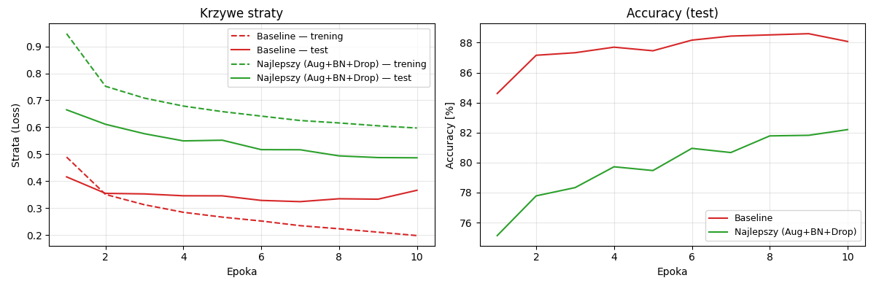
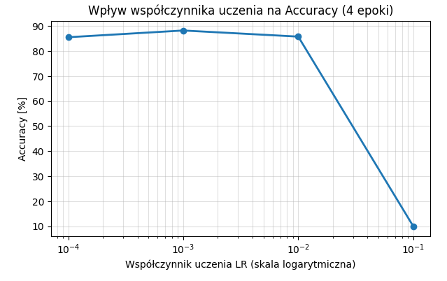

**Przedmiot:** Uczenie głębokie w systemach rozpoznawania i przetwarzania mowy
**Zajęcia nr 2 / temat:** Trenowanie i strojenie klasyfikatora obrazów
**Autor / grupa:** Adrian Zygmunt GL 5.4
**Data:** 21.10.2026

## 1. Cel ćwiczenia
Celem ćwiczenia jest wzięcie klasyfikatora obrazów (MLP dla zbioru FashionMNIST) z laboratorium 1 jako punktu odniesienia (baseline) oraz poprawa jego jakości i zdolności do generalizacji. Sprawdzone zostaną metody regularyzacji i poprawy procesu uczenia, takie jak: augmentacja danych, BatchNorm oraz Dropout. Celem dodatkowym jest przeanalizowanie wpływu wartości współczynnika uczenia Learning Rate na dokładność klasyfikatora (accuracy).

## 2. Metoda i implementacja

- **Wykorzystane narzędzia i modele:** 
  Środowisko Python, biblioteki: PyTorch, torchvision, matplotlib. 
  Model: Wielowarstwowy perceptron (MLP) z dwiema warstwami ukrytymi (256, 128 neuronów) oraz konfigurowalnymi przełącznikami dla warstw BatchNorm i Dropout.
- **Najważniejsze fragmenty kodu:** 
  Zaimplementowano uniwersalną funkcję run_training, testującą wybrane warianty. Kod znajduje się w repozytorium GitHub:
  [link do repozytorium - https://github.com/AdrianZygmunt/Uczenie-Glebokie-L2
- **Konfiguracja (parametry, dane):**
  Zbiór danych: FashionMNIST (Trening: 60000, Test: 10000).
  Parametry optymalizacji: Liczba epok: 10, Batch size: 128 (trening) / 256 (test), Optymalizator: Adam.
  Metodologia: Modyfikowano jeden czynnik naraz (augmentacja, BN, Dropout), aby jednoznacznie określić jego wpływ. Wariant docelowy połączył wszystkie metody. Augmentacja (RandomHorizontalFlip, RandomCrop) była aplikowana wyłącznie do zbioru treningowego.

- **Hipotezy przed wykonaniem eksperymentów:**
  Zastosowanie podstawowego wariantu (Baseline) doprowadzi do przeuczenia (rosnąca przerwa między stratą treningową a testową). Zastosowanie Dropoutu i Augmentacji znacząco zredukuje to zjawisko, poprawiając generalizację. Z kolei zbyt duży Learning Rate (np. 1e-1) uniemożliwi zbieżność sieci.

## 3. Wyniki

### Tabela 1. Eksperymenty - Wpływ ulepszeń na wynik po 10 epokach

| Konfiguracja | Accuracy (test) | Przerwa train-test (strata) |
|---|---|---|
| Baseline (brak regularyzacji) | 88.08% | +0.1680 |
| Tylko Augmentacja | 83.15% | -0.0159 |
| Tylko BatchNorm | 89.16% | +0.1413 |
| Tylko Dropout (p=0.3) | 88.14% | +0.0446 |
| Najlepszy (Aug+BN+Drop) | 82.20% | -0.1105 |

### Tabela 2. Zakres dodatkowy - Przegląd współczynnika uczenia (LR) dla 4 epok

| Learning Rate (LR) | Accuracy (test) | Wpływ na uczenie |
|---|---|---|
| 1e-1 (0.1) | 10.00% | Model nie zbiega (skacze w minimum lokalnym) |
| 1e-2 (0.01) | 84.73% | Model zbiega szybko, lekka niestabilność |
| 1e-3 (0.001) | 87.70% | Optymalny krok uczenia dla tego problemu |
| 1e-4 (0.0001) | 85.28% | Zbieżność zbyt wolna w zadanym budżecie epok |

### Wykresy:
a) Krzywe straty oraz accuracy dla modelu Baseline i wariantu Najlepszego:

b) Wykres wpływu współczynnika uczenia na Accuracy (skala logarytmiczna):

## 4. Analiza i interpretacja
Zgodnie z oczekiwaniami, model Baseline szybko zapamiętuje dane treningowe, co uwidacznia się rosnącą przerwą między błędem na zbiorze testowym a treningowym (0.1680) - jest to klasyczny objaw przeuczenia (overfittingu).
Dodawanie poszczególnych elementów wpłynęło na proces następująco:
*   **BatchNorm** poprawił ogólne accuracy (89.16%), ale przeuczenie nadal pozostała wysoka (0.1413).
*   **Dropout** znacznie zredukował przeuczenie (przerwa spadła do 0.0446), utrzymując wysoką dokładność na teście (88.14%).
*   **Wariant ulepszony (Augmentacja + BN + Dropout)** całkowicie zniwelował przeuczenie (-0.1105). Wartość ujemna bierze się stąd, że w trybie eval() podczas testowania sieć nie używa już augmentacji i dropoutu, przez co zadanie jest dla niej łatwiejsze niż mocno zniekształcony zbiór treningowy.

Przegląd współczynnika uczenia (LR) udowodnił, że 1e-3 to optymalna wartość dla optymalizatora Adam w tej architekturze. Próba użycia LR=0.1 całkowicie uniemożliwia trening sieci.

## 5. Wnioski
1. Użycie mechanizmów regularyzacji (Dropout) oraz augmentacji danych drastycznie ogranicza zdolność sieci do bezmyślnego zapamiętywania (overfittingu), wymuszając skupienie na istotnych cechach obrazu.
2. Silna regularyzacja przy krótkim budżecie epok (10 epok) potrafi spowolnić przyrost accuracy, ponieważ zadanie treningowe staje się o wiele trudniejsze. Przy większym budżecie epok "Najlepszy" model najprawdopodobniej prześcignąłby Baseline.
3. Współczynnik uczenia to najbardziej krytyczny hiper parametr. Dobór złego LR (np. zbyt dużego) powoduje skoki funkcji kosztu, skutkując modelem zgadującym klasy całkowicie losowo (accuracy 10% dla 10 klas równa się ślepemu trafowi). 
4. Hipotezy badawcze w pełni się potwierdziły - przeuczenie zostało skutecznie zminimalizowane za pomocą wprowadzonych.
