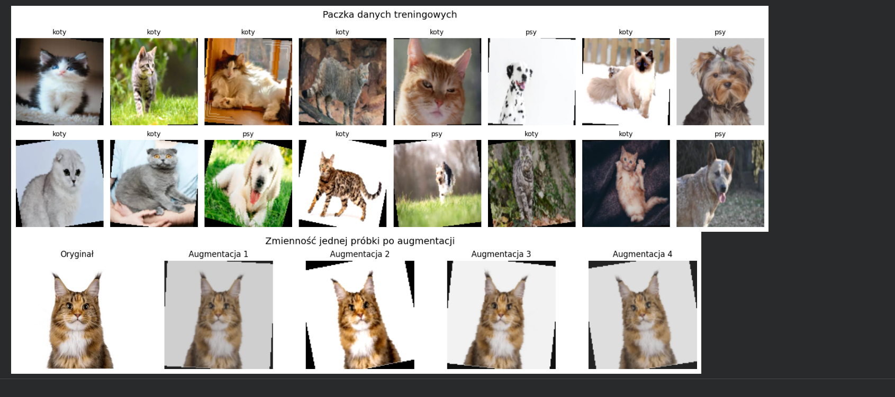

**Przedmiot:** Uczenie głębokie do rozpoznawania obiektów
**Zajęcia nr / temat:** 3 / Dane obrazowe i wideo – potok danych pod lupą
**Autor / grupa:** Adrian Zygmunt GL 5.4
**Data:** 28.10.2026

## 1. Cel ćwiczenia
Celem ćwiczenia było skonfigurowanie i zweryfikowanie kompletnego potoku danych od plików graficznych do gotowych paczek tensorów. Skupiono się na zdefiniowaniu dwóch klas ("psy" i "koty"), odpowiednim podziale zbioru oraz na wdrożeniu i weryfikacji odpowiednich potoków transformacji obrazu (w tym augmentacji) przed procesem uczenia.

## 2. Metoda i implementacja

- **Wykorzystane narzędzia:** PyTorch, torchvision, matplotlib, pandas
- **Najważniejsze fragmenty kodu:** https://github.com/AdrianZygmunt/Uczenie-g-bokie-do-rozpoznawania-obiekt-w/tree/main/L3
- **Konfiguracja (parametry, dane):**
  Zbiór wejściowy z Google Drive (zdjęcia psów i kotów). Zbiór podzielono na część treningową (80%) i walidacyjną (20%). Opracowano potok ewaluacyjny (Resize 128x128, ToTensor, Normalize) oraz potok treningowy z dodaną augmentacją. Rozmiar paczki (batch_size) wynosił 16.
- **Uzasadnienie augmentacji:** W zbiorze treningowym zastosowano `RandomHorizontalFlip`, losowy obrót do 15 stopni (`RandomRotation`) oraz lekkie zmiany jasności i kontrastu (`ColorJitter`). Operacje te wymuszają różnorodność próbek bez wpływu na klasę – odbity lustrzanie, przyciemniony czy obrócony kot to wciąż ten sam obiekt z klasą "koty".

## 3. Wyniki

**Statystyki zbioru:**
* Treningowy: 2 klasy, 26 obrazów z klasy "koty", 22 z klasy "psy", rozmiar tensora: `torch.Size([3, 128, 128])`.
* Walidacyjny: 2 klasy, 4 obrazy z klasy "koty", 8 z klasy "psy", rozmiar tensora: `torch.Size([3, 128, 128])`.

| Indeks | Część zbioru | Liczba klas | koty | psy | Rozmiar tensora           |
|---|--------------|-------------|------|-----|---------------------------|
| 0 | Treningowy   | 2           | 26   | 22  | torch.Size([3, 128, 128]) |
| 1 | Walidacyjny  | 2           | 4    | 8   | torch.Size([3, 128, 128]) |

**Audyt przykładowej paczki z DataLoader (trening):**
* Kształt paczki: `torch.Size([16, 3, 128, 128])`
* Typ tensora: `torch.float32`
* Zakres wartości tensora: min = -1.0, max = 1.0
* Wylosowane etykiety: `[0, 0, 0, 0, 0, 1, 0, 1, 0, 0, 1, 0, 1, 0, 0, 1]`

**Podgląd wczytanych danych i augmentacji:**

* **Przykładowa paczka danych (góra):** 16 losowych zdjęć wraz z etykietami, pokazanych dokładnie w takiej postaci, w jakiej trafią do sieci na etapie treningu. Widać na nich wyraźnie efekty modyfikacji, na przykład obrócone kadry[cite: 8].
* **Wpływ augmentacji na jedno zdjęcie (dół):** Oryginał i cztery zmienione wersje tego samego zdjęcia. Zestawienie to dobrze pokazuje, że nakładane na obraz zmiany są zróżnicowane i losowe, ale zdjęcie nie traci przez to sensu – na każdej z wersji wciąż bez problemu widać kota, więc klasa obrazu pozostaje w 100% prawidłowa[cite: 8].

## 4. Analiza i interpretacja
Wyświetlenie w notatniku poszczególnych tensorów oraz siatki zdjęć wyczerpująco potwierdza poprawność zaimplementowanego potoku. Odpowiednie kroki normalizujące przesunęły wartości piskeli do oczekiwanego zakresu [-1, 1], co jest konieczne dla poprawnego działania większości modeli głębokich. Przetestowanie augmentacji na pojedynczej próbce dowodzi, że funkcja odpowiednio wstrzykuje szum rotacyjny i zmianę balansu kolorów bez negatywnego wpływu na interpretację zdjęcia dla ludzkiego oka.

## 5. Wnioski
1. Prawidłowo zaimplementowany potok z użyciem klas `ImageFolder` i `DataLoader` całkowicie automatyzuje masowe wczytywanie i skalowanie zróżnicowanych danych wejściowych.
2. Zastosowana wyłącznie na zbiorze treningowym augmentacja zróżnicuje wejście uczącej się w przyszłości sieci, znacząco podnosząc jej zdolność generalizacji bez dodatkowego powiększania właściwej objętości danych na dysku.
3. Dokładny audyt paczki tensorów na wstępnym etapie prac to kluczowy krok przed rozpoczęciem projektowania modelu, chroniący przed trudnymi w detekcji błędami kształtów lub skalowania w późniejszych fazach treningu.
