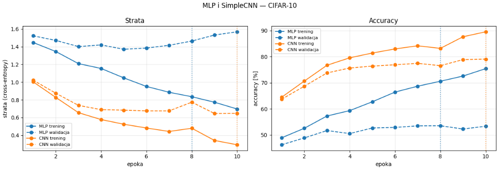

**Przedmiot:** Uczenie głębokie w systemach rozpoznawania i przetwarzania mowy
**Zajęcia nr / temat:** 4 / Splotowe sieci neuronowe (CNN) - porównanie z MLP na zbiorze CIFAR-10
**Autor / grupa:** Adrian Zygmunt GL 5.4
**Data:** 4.11.2026

## 1. Cel ćwiczenia
Celem ćwiczenia było wytrenowanie sieci wielowarstwowego perceptronu (MLP) oraz prostej sieci splotowej (SimpleCNN) na zbiorze obrazów CIFAR-10 w identycznych warunkach, a następnie porównanie ich wyników pod kątem dokładności (accuracy), liczby parametrów, tendencji do przeuczenia oraz czasu uczenia. 

## 2. Metoda i implementacja
- **Wykorzystane narzędzia i sprzęt:** Python, PyTorch, torchvision, matplotlib, środowisko Google Colab z akceleratorem GPU: **Tesla T4**.
- **Konfiguracja (CFG):** Oba modele zostały wytrenowane przy użyciu tej samej konfiguracji: 
  - `epochs`: 10, `lr`: 1e-3, `batch_size`: 128, `n_val`: 5000, `augment`: False, `seed`: 42.
- **Modele:**
  - **MLP**: Spłaszcza obraz do wektora 3072, posiada warstwy gęste.
  - **SimpleCNN**: Posiada część splotową (features) wykorzystującą sploty 2D i pooling oraz głowicę (classifier) opartą na warstwach gęstych.

## 3. Wyniki

**Tabela: Zestawienie wyników modeli na zbiorze CIFAR-10**

| Model | Parametry | Epoka | Acc Trening | Acc Walidacja | Przerwa (Train-Val) | Acc Test | Czas (s) |
|---|---|---|---|---|---|---|---|
| **MLP** | 1,707,274 | 8 | 70.59% | 53.54% | 17.05% | 52.03% | 102.2 |
| **CNN** | 1,117,354 | 10 | 89.54% | 79.08% | 10.46% | 78.68% | 117.8 |

*Szczegóły parametrów CNN:* Część splotowa: 65,952, Głowica: 1,051,402.
*Klasyfikator losowy dla CIFAR-10:* 10.00%.

**Krzywe uczenia:**

## 4. Analiza i interpretacja
Z powyższych danych wyraźnie wynika, że architektura CNN jest znacznie lepiej przystosowana do przetwarzania obrazów niż klasyczne MLP. Sieć CNN uzyskała dokładność testową na poziomie blisko 79%, deklasując MLP, które osiągnęło zaledwie 52%. Mimo że CNN posiada ogółem mniej parametrów (ok. 1.1 mln w porównaniu do 1.7 mln w MLP), to dzięki własnościom warstw splotowych – takim jak współdzielenie wag i zachowanie lokalnych zależności przestrzennych pikseli – potrafi wyciągać znacznie bardziej użyteczne cechy z obrazu. 

Zauważalne jest również mniejsze przeuczenie w przypadku CNN: przerwa między accuracy treningowym a walidacyjnym wyniosła 10.46%, podczas gdy MLP bardzo szybko zaczęło dopasowywać się do danych treningowych "na pamięć", kończąc z wysoką różnicą rzędu 17.05%.

## 5. Wnioski
1. Sieci splotowe (CNN) deklasują klasyczne sieci gęste (MLP) w problemach wizyjnych, co potwierdza znacząca różnica w accuracy na korzyść SimpleCNN.
2. CNN jest bardziej wydajne pod względem architektury: sama część splotowa wymagała do nauczenia zaledwie niecałych 66 tysięcy parametrów, a pozwoliła na drastyczną poprawę jakości klasyfikacji.
3. Pomimo nieco dłuższego czasu samej operacji splotu (trening 117.8 s vs 102.2 s dla MLP), zysk ze skuteczności i lepszej generalizacji zdecydowanie przewyższa ten narzut czasowy.