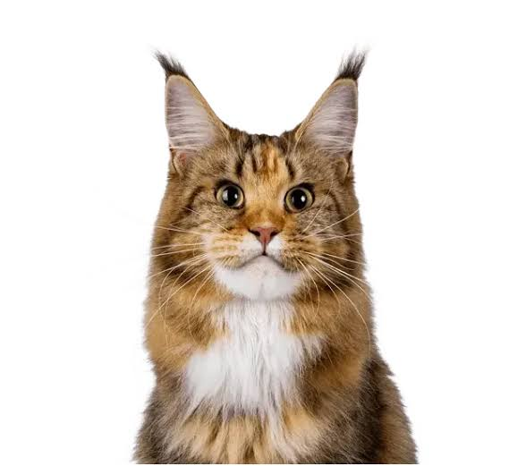
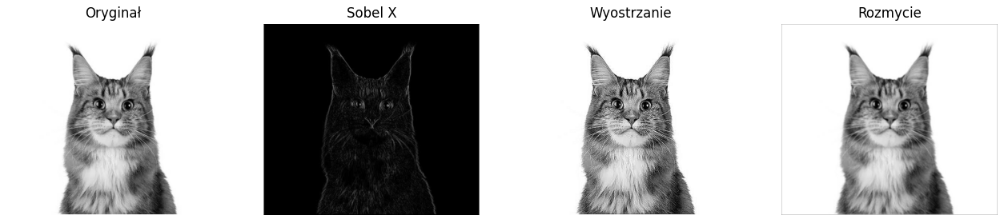
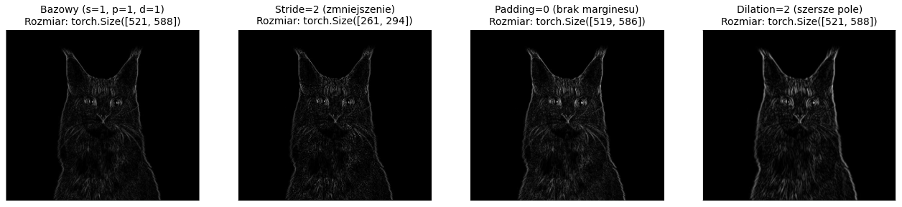
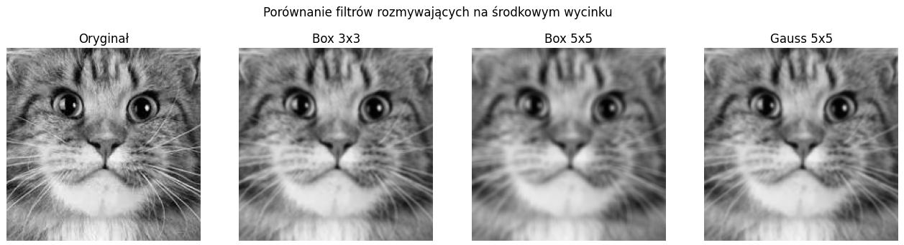
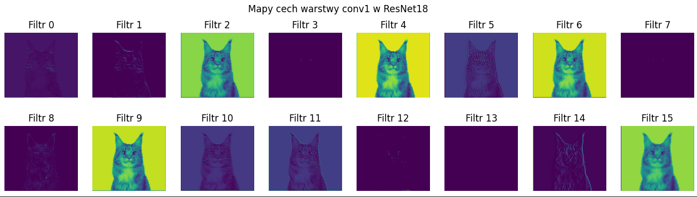

**Przedmiot:** Uczenie głębokie do rozpoznawania obiektów
**Zajęcia nr / temat:** 5 / Warstwy splotowe - operacja, parametry, interpretacja
**Autor / grupa:** Adrian Zygmunt GL 5.4 
**Data:** 13.11.2026

## 1. Cel ćwiczenia
Celem ćwiczenia było zbadanie działania warstwy splotowej na obrazie w skali szarości. Weryfikowano jak odpowiedni dobór wag jądra (filtru) decyduje o reakcji na obraz. Analizowano i sprawdzano w praktyce wpływ parametrów splotu: rozmiaru jądra ($k$), kroku ($s$), dopełnienia ($p$) i dylatacji ($d$) na geometrię oraz wymiary wyjściowej mapy cech, porównując wyniki ze wzorem teoretycznym.

## 2. Metoda i implementacja
- **Wykorzystane narzędzia i sprzęt:** Python, biblioteki PyTorch (`torch.nn`, `torch.nn.functional`), `torchvision`, `matplotlib`, środowisko Google Colab
- **Dane wejściowe:** Własne zdjęcie w skali szarości (`kot_11.jpg`). Obraz został wczytany i przekształcony do tensora o docelowym kształcie `[1, 1, 521, 588]`.
- **Zdjęcie wykorzystane w zadaniu:**

- **Zdefiniowane filtry ręczne:**
  - **Sobel X** ($3\times3$): Detekcja krawędzi pionowych.
  - **Sharpen** ($3\times3$): Wyostrzanie lokalnego kontrastu.
  - **Blur (Box)** ($3\times3$): Wygładzanie obrazu (uśrednianie z wagami $\frac{1}{9}$).
- **Kod:** https://github.com/AdrianZygmunt/Uczenie-g-bokie-do-rozpoznawania-obiekt-w/tree/main/L5
## 3. Wyniki

### 3.1. Porównanie wymiarów ze wzorem
Wzór użyty do obliczeń: $out = \lfloor \frac{in + 2p - d(k-1) - 1}{s} \rfloor + 1$

| $k$ (rozmiar) | $s$ (krok) | $p$ (padding) | $d$ (dylatacja) | Wzór | Zwrócone przez `Conv2d` | Status |
|:---:|:---:|:---:|:---:|:---:|:---:|:---:|
| 3 | 1 | 1 | 1 | 588 | 588 | OK |
| 5 | 2 | 2 | 1 | 294 | 294 | OK |
| 3 | 1 | 2 | 2 | 588 | 588 | OK |
| 7 | 3 | 0 | 1 | 194 | 194 | OK |
| 5 | 1 | 4 | 2 | 588 | 588 | OK |

### 3.2. Działanie filtrów ręcznych (Sobel X, Sharpen, Blur)

### 3.3. Wpływ parametrów krok (stride), dopełnienie (padding) i dylatacja (dilation) na geometrię wyjścia

### 3.4. Porównanie działania filtrów Box $3\times3$, Box $5\times5$ oraz rozmycia Gaussa $5\times5$ na wybranym fragmencie obrazu.

### 3.5. Wizualizacja map cech (ResNet-18, conv1)

## 4. Analiza i interpretacja

**Ręczne jądra i mapy cech:**
Zastosowanie określonych wag drastycznie zmienia mapę odpowiedzi:
*   **Sobel X:** Wagi przyjmują wartości ujemne w lewej kolumnie i dodatnie w prawej, przez co po nałożeniu jądra na obraz silnie reagują na nagłe zmiany jasności w osi X. Efektem na mapie jest wyraźne podświetlenie pionowych krawędzi obiektów.
*   **Sharpen:** Środkowa waga to $+5$, a jej bezpośredni sąsiedzi w poziomie i pionie mają wagi $-1$. Gdy środkowy piksel różni się jasnością od otoczenia, ta różnica zostaje wzmocniona, co powoduje wizualne "wyostrzenie" i podkreślenie drobnych tekstur obrazu.
*   **Rozmycie (Box $3\times3$ vs Box $5\times5$ vs Gaussian $5\times5$):** Zwiększenie jądra Box z $3\times3$ (wagi $\frac{1}{9}$) do $5\times5$ (wagi $\frac{1}{25}$) skutkuje uwzględnieniem większego sąsiedztwa – krawędzie są silniej uśredniane, a drobne detale zacierają się szybciej. Z kolei filtr *Gaussian $5\times5$* nadaje największą wagę centrum, a udziały maleją z odległością. Daje to efekt łagodniejszego, bardziej "naturalnego" wygładzenia niż w przypadku klockowatego uśredniania filtra *Box*.

**Interpretacja cech głębszych sieci:**
Podczas korzystania z gotowych, wyuczonych wag (jak na pierwszych warstwach np. ResNet-18), mapy cech wykazują wyuczoną zdolność detekcji konkretnych cech bazowych, np. skośnych krawędzi lub kontrastów barwnych. Te proste lokalne fragmenty łączą się na wyższych poziomach architektury w rozpoznawanie głębokich i skomplikowanych tekstur.

## 5. Wnioski
1. Pojedyncza operacja splotu z odpowiednio wytypowanymi wagami pozwala na skuteczną ekstrakcję istotnych informacji z obrazu (np. krawędzi lub gradientów).
2. Wyniki implementacji z modułu `torch.nn.Conv2d` wykazują pełną zgodność z modelem teoretycznym geometrii (wzorami na wymiary wejścia/wyjścia).
3. Do redukcji przestrzennej (downsamplingu) najefektywniej wykorzystuje się parametr *kroku (stride)*. Z kolei *dylatacja (dilation)* to optymalne narzędzie do zwiększania widoczności (pola recepcji) filtra bez nadmiernego zwiększania liczby parametrów obliczeniowych, co bywa pożądane w głębokich sieciach i segmentacji obrazu.
