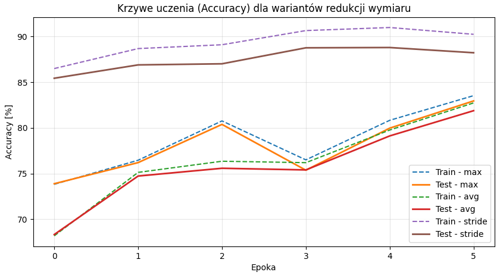

**Przedmiot:** Uczenie głębokie do rozpoznawania obiektów
**Zajęcia nr / temat:** 6 / Warstwa łącząca (pooling) i pełna CNN
**Autor / grupa:** Adrian Zygmunt GL 5.4
**Data:** 18.11.2026

## 1. Cel ćwiczenia
Celem ćwiczenia było zbudowanie pełnej splotowej sieci neuronowej (CNN) na zbiorze FashionMNIST oraz zbadanie wpływu sposobu redukcji wymiarów mapy cech na jakość klasyfikacji. Porównano trzy warianty zmniejszania rozdzielczości: max pooling 2×2, average pooling 2×2 oraz splot 3×3 z krokiem 2 (stride). Dla każdego z nich wyznaczono dokładność testową (accuracy), liczbę parametrów oraz rozmiar mapy cech przed głowicą klasyfikującą.

## 2. Metoda i implementacja
- **Narzędzia:** Python, PyTorch, torchvision, matplotlib, środowisko Google Colab (GPU).
- **Dane:** Zbiór FashionMNIST (60 000 obrazów treningowych, 10 000 testowych, 10 klas, obrazy 28×28 w skali szarości) poddany normalizacji (średnia 0,2860, odchylenie standardowe 0,3530).
- **Architektura:** Dwa bloki `Conv 3×3 (padding=1) → BatchNorm → ReLU → redukcja` (32 i 64 kanały), zakończone głowicą `GAP → Flatten → Linear(64, 10)`. Zastosowane warianty redukcji:
  - `max` – `MaxPool2d(2)`,
  - `avg` – `AvgPool2d(2)`,
  - `stride` – dodatkowa warstwa `Conv 3×3, stride=2, padding=1 → BatchNorm → ReLU`.
- **Trening:** Optymalizator Adam (lr = 1e-3), 6 epok, rozmiar paczki (batch size) 128, funkcja straty `CrossEntropyLoss`, stałe ziarno losowości (seed = 42) ustawiane przed każdym modelem, brak augmentacji danych. Wszystkie ustawienia poza metodą redukcji były identyczne dla każdego wariantu.
- **Kod:** Wklej link do GitHuba

## 3. Wyniki

Tabela 1: Porównanie wariantów redukcji wymiaru mapy cech (accuracy testowa po 6. epoce)

| Wariant | Liczba parametrów | Mapa cech [C, H, W] | Accuracy testowa | Przerwa train–test |
|:---:|:---:|:---:|:---:|:---:|
| `max` | 19 658 | [64, 7, 7] | 82,95% | 0,58% |
| `avg` | 19 658 | [64, 7, 7] | 81,88% | 0,85% |
| `stride` | 66 026 | [64, 7, 7] | 88,22% | 2,02% |

Wartości dokładności testowej podano dla ostatniej (6.) epoki, a nie jako maksimum z przebiegu krzywej uczenia. Rozmiary map cech przed głowicą okazały się identyczne we wszystkich wariantach, ponieważ kolejne wymiary (28 → 14 → 7) dzielą się bez reszty. Różnica między zaokrąglaniem w dół (pooling) a w górę (splot ze stride) ujawniłaby się dopiero dla wymiarów nieparzystych (np. 7 → 3 dla poolingu wobec 7 → 4 dla splotu).

Na liczbę parametrów w wariantach `max` i `avg` składają się: 384 parametry (blok 1) + 18 624 (blok 2) + 650 (głowica) = 19 658. W wariancie `stride` dochodzą dwie dodatkowe warstwy splotowe z normalizacją BatchNorm: 9 312 + 37 056 = 46 368, co daje łącznie 66 026 parametrów.

**Wykres 1: Krzywe accuracy dla badanych wariantów redukcji wymiaru**

*Accuracy treningowa (linia przerywana) i testowa (ciągła) w kolejnych epokach dla wszystkich trzech wariantów.*

## 4. Analiza i interpretacja
1. Max pooling a average pooling: Oba warianty posiadają identyczną liczbę parametrów, ponieważ warstwy łączące nie zawierają uczonych wag. Max pooling uzyskał wynik lepszy o ok. 1 p.p., co wynika z faktu, że operacja maksimum zachowuje najsilniejszą aktywację filtra w oknie, podczas gdy uśrednianie ją wygładza. Różnica ta jest jednak niewielka, a eksperyment przeprowadzono dla pojedynczego uruchomienia (jednego ziarna losowości), przez co nie stanowi ona podstawy do wyciągania kategorycznych wniosków.
2. Splot ze stride: Wariant ten osiągnął najwyższą dokładność (88,22%), przewyższając max pooling o ponad 5 p.p. Należy jednak uwzględnić, że model ten ma ponad trzykrotnie więcej parametrów (66 026 wobec 19 658) oraz dwie dodatkowe warstwy z nieliniowością, co czyni sieć głębszą. Poprawa jakości jest zatem rezultatem zarówno uczonego sposobu agregacji sąsiedztwa (zamiast sztywnej reguły), jak i większej pojemności modelu.
3. Kompromis między jakością a liczbą parametrów: Wzrost dokładności o ok. 5 p.p. wiąże się z narzutem ok. 46 tys. dodatkowych parametrów oraz większą przerwą między zbiorem treningowym a testowym (2,02% wobec 0,58% dla max poolingu). Przy 6 epokach przeuczenie pozostaje niewielkie, ale rośnie wraz z pojemnością architektury. W zadaniach wymagających lekkiego modelu wystarczający jest max pooling, natomiast gdy priorytetem jest skuteczność klasyfikacji, korzystniejszy okazuje się splot ze stride.
4. Rola warstwy GAP: Zastosowanie Global Average Pooling ogranicza liczbę parametrów głowicy do zaledwie 650. Dla porównania, bezpośrednie spłaszczenie całej mapy cech (3136 wartości) wymagałoby 31 370 parametrów (wyliczenie teoretyczne; wariant ze spłaszczeniem nie był poddawany testom eksperymentalnym).

## 5. Wnioski
1. Wszystkie trzy metody redukcji wygenerowały mapę cech o tym samym rozmiarze [64, 7, 7], zatem różnice w końcowych wynikach wynikają bezpośrednio ze sposobu agregacji informacji.
2. Przy tej samej liczbie parametrów (19 658) max pooling (82,95%) sprawdził się nieznacznie lepiej niż average pooling (81,88%).
3. Najwyższą skuteczność klasyfikacji uzyskano dla splotu ze stride (88,22%), jednak odbyło się to kosztem znacznego wzrostu liczby parametrów (66 026) oraz największej przerwy train–test (2,02%), przy czym część zysku wynika ze zwiększonej głębokości i pojemności sieci.